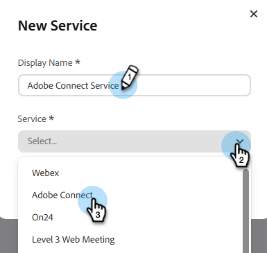

# 将[!DNL Adobe Connect]添加为[!DNL LaunchPoint]服务 {#add-adobe-connect-as-a-launchpoint-service}

Marketo管理您的[!DNL Adobe Connect]网络研讨会注册和出席情况。

>[!PREREQUISITES]
>
>* 需要[!DNL Adobe Connect]的现有订阅和管理权限。 现有以下详细信息：用户名、密码、参与者密码和会议文件夹URL。

>[!NOTE]
>
>* **需要管理员权限**
>* 当前不支持[!DNL Adobe Connect On Site]。

1. 在“我的Marketo”中，单击&#x200B;**[!UICONTROL Admin]**。

1. 在&#x200B;**[!UICONTROL Integration]**&#x200B;下，选择&#x200B;**[!UICONTROL LaunchPoint]**。

   

1. 单击&#x200B;**[!UICONTROL New]**&#x200B;并选择&#x200B;**[!UICONTROL New Service]**。

   

1. 输入&#x200B;**[!UICONTROL Display Name]**。 在&#x200B;**[!UICONTROL Service]**&#x200B;下拉列表中，选择&#x200B;**[!UICONTROL Adobe Connect]**。

   

1. 输入您的&#x200B;**[!UICONTROL Username]**、**[!UICONTROL Access Code]**、**[!UICONTROL Meeting Folder URL]**&#x200B;和&#x200B;**[!UICONTROL Participant Password]**，然后单击&#x200B;**[!UICONTROL Create]**。

   

   >[!TIP]
   >
   >创建参与者密码时，您选择的值将在发送事件链接时包含在查询字符串中。 建议您将它设为对客户友好的版本。

   >[!NOTE]
   >
   >登录[!DNL Adobe Connect]帐户后，选择&#x200B;**[!UICONTROL Seminars]**&#x200B;选项卡。 无需深入了解任何特定研讨会，即可将URL从浏览器栏复制到&#x200B;**[!UICONTROL Meeting Folder URL]**&#x200B;设置。

您的[!DNL Adobe Connect]服务现已与Marketo Engage同步。

>[!MORELIKETHIS]
>
>了解如何[使用 [!DNL Adobe Connect]](/help/marketo/product-docs/demand-generation/events/create-an-event/create-an-event-with-adobe-connect.md){target="_blank"}创建事件。
