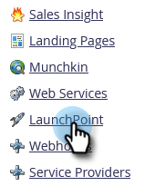
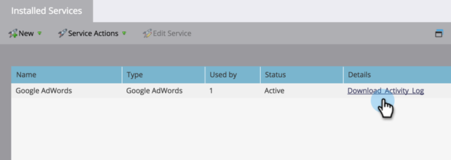

# 下载[!DNL Google Adwords]活动日志 {#download-googleadwords-activity-log}

了解如何下载活动日志以解决问题。

1. 在“我的Marketo”中，单击&#x200B;**[!UICONTROL Admin]**。

   

1. 单击 **[!UICONTROL LaunchPoint]**。

   

1. 找到您的[!DNL Google AdWords]服务并单击&#x200B;**[!UICONTROL Download Activity Log]**。

   

1. .zip文件下载到您的计算机。
