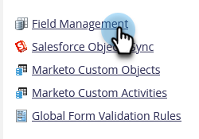
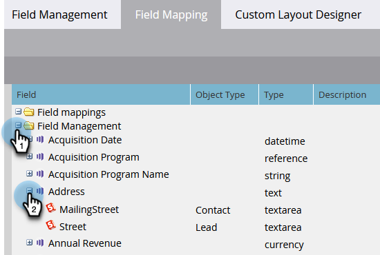

# 查看Marketo和[!DNL Salesforce]之间的字段映射 {#view-field-mappings-between-marketo-and-salesforce}

您可能想知道特定Marketo字段映射到哪些[!DNL Salesforce]字段。 请按照以下步骤操作。

>[!NOTE]
>
>**需要管理员权限**

1. 在“我的Marketo”中，单击&#x200B;**[!UICONTROL Admin]**。

   

1. 单击 **[!UICONTROL Field Management]**。

   

1. 找到您感兴趣的字段，然后单击&#x200B;**+**&#x200B;展开映射。

   

>[!NOTE]
>
>这会显示[!DNL Salesforce] API名称，而不是标签名称。

>[!IMPORTANT]
>
>列出的字段仅反映来自初始映射的数据。 在Marketo/[!DNL Salesforce]同步后，它们不会更新。
