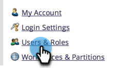
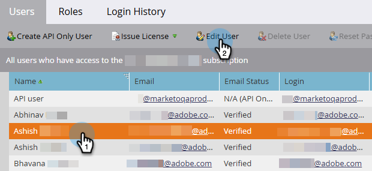
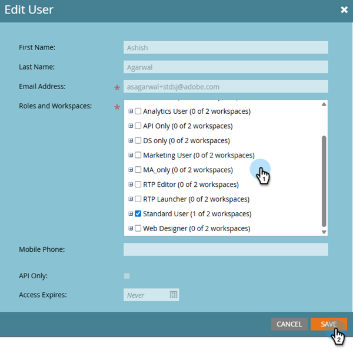

# 编辑用户工作区 {#edit-user-workspaces}

1. 在“我的Marketo”中，单击&#x200B;**[!UICONTROL Admin]**。

   

1. 单击 **[!UICONTROL Users & Roles]**。

   

1. 选择所需的用户并单击&#x200B;**[!UICONTROL Edit User]**。

   

1. 进行所需的更改并单击&#x200B;**[!UICONTROL Save]**。

   
